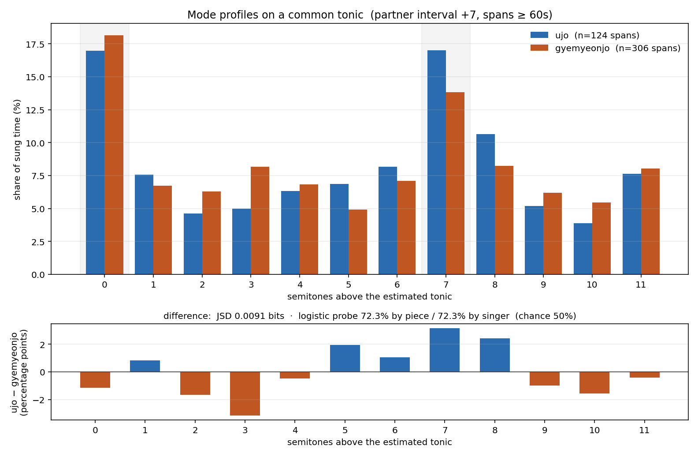

# Melody — generating the note skeleton from lyrics

Everything downstream of `make_ds.py from-score` already works: hand it a text score and it
becomes a `.ds`, then f0, then a mel, then a wav ([`PIPELINE.md`](PIPELINE.md) §D). What does
not exist is the thing that *writes* the score. Today a human does, or the notes are copied
out of an existing recording's labels.

This is the plan for a model that writes it, and the record of the one stage that is built.

The target is not "a melody" but **a melody in a named mode** — ujo, gyemyeonjo — because that
is the axis a pansori score is actually chosen along, and because the corpus already carries
the label: `segments.jsonl` has a human-annotated `mode` per utterance.

---

## 0. What is settled

**Settled — the output format.** The generator emits the text score `make_ds.py from-score`
already reads (`syllable note duration_seconds`, `-` for a held syllable, `_` for a rest). So
the seam between the new work and the working pipeline is a file format that exists, and the
melody model can be replaced wholesale without touching anything below it.

**Settled — the two decisions inside stage [2].**

- **Note duration is a classification, not a regression.** A syllable's length is not a
  function of its lyrics — the singer decides — so L1 or MSE is minimised by the mean and the
  model returns 0.3 s every time. The same failure the f0 predictor already has
  ([`SIGIMSAE_PLAN.md`](SIGIMSAE_PLAN.md): the model moves 12–20% as much as ground truth).
  Durations go into **40 bins** (§3); measured requantisation error is 4.3 ms at the median,
  under one frame at hop 512 / 44.1 kHz, so the binning gives up nothing the binariser would
  have kept.
- **Notes per syllable is emitted, not predicted as a count.** One note at a time, then
  `CONT` or `NEXT`. 66.6% of syllables take one note but 6.3% take six or more, so a fixed
  count vocabulary truncates the very thing — sigimsae — the model exists to produce. `CONT`
  is the text score's `-` exactly.

Because the destination is a `.ds` measured in **seconds**, none of this needs a beat grid,
which is fortunate: the corpus has no jangdan annotation. The bar/position tokens every
lyric-to-melody paper uses are a detour we do not have to take.

**Settled, as of §2 — the mode is in the notes.** This was the question that decided whether
any of the rest was worth building, and it is now answered: a probe reads ujo from gyemyeonjo
at **72.3%** balanced accuracy off the note skeleton alone, and holds at 72.3% with whole
singers held out. What follows is the evidence, kept because the raw numbers say the opposite
and it is worth knowing why.

Measured on the raw note sequence, before any tonic-relative conversion, ujo and gyemyeonjo
are nearly indistinguishable:

| mode | repeat (0) | +1 | −1 | −2 | +2 | leaps ≥5 |
|---|---|---|---|---|---|---|
| gyemyeonjo | 27.6% | 12.7% | **17.1%** | 10.3% | 5.5% | 11.3% |
| ujo | 27.1% | **14.9%** | 14.7% | 8.2% | 6.8% | 13.6% |
| pyeongjo | 27.9% | 13.4% | 16.4% | 8.6% | 6.9% | 12.6% |

Only the direction separates them — gyemyeonjo descends more than it rises, ujo does not — and
by 3–4 points. Two reasons it may be hiding rather than absent:

1. **There is no tonic.** A mode is defined against a reference pitch, and our notes are
   absolute names (`A#4`). Every singer and piece sits somewhere different, so one mode's
   skeletal tones land on another's note names. Stage S3 exists to fix this.
2. **Part of the mode is not in the notes.** The bent and shaken tones that identify
   gyemyeonjo are f0 movement inside a note, which in this pipeline belongs to the variance
   model's `base_pitch + deviation`, not to the note skeleton.

**S3 was therefore the gate.** It needs no training — it is an aggregation over notes we
already have. Reason (1) turned out to be most of it: §2.

---

## 1. Data preparation

```
 segments.jsonl     mode, uuid, duration
 phones_sofa2.jsonl words tier = the syllable sequence, on the audio clock
 notes.jsonl        ROSVOT notes, on the same clock, having never seen the lyrics
 lyrics.jsonl       the text
         │
         ▼
   S2  bind_notes.py        syllable -> its notes, and the quality verdict      ✅ built
         ▼
   melody_data.jsonl
         │
   S3  tonic.py             per-piece tonic + per-mode profile                  ✅ §2
   S4  tokens.py            degrees, duration bins, CONT/NEXT                  ✅ §3
```

### Why it reads `phones_sofa2.jsonl` and not `transcriptions.csv`

The unit this needs is the **syllable**, and only the SOFA arm has it.

| | words tier == the syllable list | phones under 20 ms |
|---|---|---|
| MFA (`phones.jsonl`) | 7.5% | 4.2% |
| **SOFA2 (`phones_sofa2.jsonl`)** | **100.0%** | 24.4% |

SOFA is handed one syllable per dictionary headword (`align.yaml` `lab_unit: syllable`), so its
words tier *is* the syllable sequence. MFA's is in eojeol, and 06_merge only splits an eojeol
back into syllables when the dictionary's predicted phonemes match the actual ones exactly
(`PIPELINE.md` §06 ⑤) — which, measured against the lyrics, leaves 23.2% of utterances at
syllable granularity.

But reading the *merged* output loses it again: `merge_tiny` folds sub-20 ms phones into a
neighbour, and where every phone of a syllable is folded the syllable disappears. SOFA has
24.4% of its phones under that threshold, so the SOFA corpus's `transcriptions.csv` is down to
28.0%. **The 100% is only available above 06_merge**, and since the melody model uses no
phonemes at all, that is where this branches off.

### S2 — binding, `melody/bind_notes.py`

Two timelines that have never met: syllables from the aligner, notes from ROSVOT. Binding them
means cutting the note sequence into one contiguous run per syllable, maximising the total
syllable/note overlap.

**Greedy does not work**, which is the only reason this is a DP. Handing each note to whichever
syllable overlaps it most starves short syllables of everything they share with a longer
neighbour. On `02b8fd02_0000` ("아이고 장군님") it leaves two syllables of six with no note:

```
greedy   아←A4   이←(none)   고←F#4,B3   장←B3,C#4,C#4   군←C4   님←(none)
DP       아←A4   이←F#4      고←B3       장←B3,C#4       군←C#4  님←C4
```

The assignment has to be monotonic and every syllable has to receive at least one note, so it
is the same shape of problem as `make_ds.derive_note_slur` — and for the same reason that
function is a DP too. Running-maximum inner loop, so O(syllables × notes).

**Notes keep ROSVOT's own spans, uncut.** A note reaching past its syllable's end stays whole:
the note is the musical unit, not the syllable.

**Rests are stored separately.** They belong to no syllable and so have no place in the
syllable list, but 74.3% of utterances have an uncovered stretch over 50 ms (8.0% of utterance
time on average). Dropping them would produce a score with nowhere to breathe.

**Tokens are deliberately not stored.** Bin counts and the tonic estimate will move while the
DP above them will not; baking tokens into the file would mean re-running the DP over the
corpus to change a bin count. The file holds MIDI numbers and seconds; S4 is a lookup applied
at load time.

```sh
python pansori/melody/bind_notes.py --set full        # any env
```

One row per utterance, failures included so a threshold can be revisited without a rebuild:

```json
{"item_name": "02b8fd02_0000", "uuid": "02b8fd02", "mode": "계면조",
 "duration": 2.688, "text": "아이고 장군님",
 "syllables": [{"syl": "아", "start": 0.0, "end": 0.2147, "notes": [[69, 0.0, 0.2145]]},
               {"syl": "장", "start": 0.7517, "end": 1.3961,
                "notes": [[59, 0.8372, 1.1304], [61, 1.1304, 1.2804]]}],
 "rests": [],
 "qc": {"min_syl_dur": 0.0784, "n_syl_no_note": 0,
        "n_syllables": 6, "n_notes": 7, "pass": true}}
```

`uuid` is carried because **hold-out splits go by piece, never by utterance** — the same
passage recurs across utterances of one recording, and splitting below the piece puts it on
both sides.

### What survives

| | utterances | hours |
|---|---|---|
| gyemyeonjo | 10,309 | 10.87 |
| ujo | 3,081 | 3.24 |
| pyeongjo | 854 | 0.90 |
| seolleongje | 112 | 0.11 |
| gyeongdeureum | 57 | 0.06 |
| **total** | **14,413 of 26,955 (53.5%)** | |

92,716 syllables · 161,796 notes — **1.75 notes per syllable, 42.2% of syllables carrying more
than one.** That last figure is the whole argument for `CONT`: the one-syllable-one-note
assumption every lyric-to-melody paper makes would discard two fifths of this corpus's melodic
structure.

Why the other 46.5% goes:

| reason | utterances |
|---|---|
| a syllable whose assigned notes do not overlap it | 10,526 |
| a syllable under 0.03 s | 8,103 |
| fewer notes than syllables | 1,707 |

Only the second is SOFA's doing — cramming the tail of an utterance it has lost into a few
milliseconds, the price of the syllable tier it gives in exchange. Running the same binding
over the MFA alignment separates the two:

| | pass | no overlapping note | under 0.03 s | too few notes |
|---|---|---|---|---|
| MFA (eojeol units) | 54.8% | 11,770 | 318 | 226 |
| SOFA2 (syllable units) | 53.5% | 10,526 | 8,103 | 1,707 |

**The dominant cause is not the aligner.** It costs MFA slightly more than SOFA2 despite MFA's
units being coarser, so it is a property of the note track, not of the syllable track. Nor is
it simply syllables sung where ROSVOT found nothing: only 13.1% of them fall inside a rest. It
is undiagnosed, and it is the first thing to look at if 14,413 utterances turn out to be too
few.

The test is deliberately the strict one: if the DP could only satisfy "every syllable gets a
note" by handing one a note it does not overlap, that syllable's melody is a product of the
constraint rather than an observation. Relaxing it to one such syllable per utterance would
recover 1,591 utterances (53.5% → 59.4%); the `qc` fields are stored so that can be
reconsidered without rebuilding.

The unit difference is visible in the totals too: MFA's 14,774 rows carry 68,193 eojeol at 2.43
notes each, SOFA2's 14,413 carry 92,716 syllables at 1.75. Same music, cut at a different
granularity — and only the finer one is a unit the model can be asked to sing.

Separately, 765 aligned utterances have no note slice at all and never enter the file.

---

## 2. Tonic estimation — what degrees are measured from

`melody/tonic.py`. Trains nothing: a duration-weighted pitch-class histogram per (piece, mode)
span, each rotated onto its own estimated tonic.

It exists for S4. `A#4` means nothing on its own — the same scale degree wears a different
pitch name in every recording, so a model trained on names learns the recordings. It doubles
as the gate of §0, because once every piece is on a common tonic the modes can finally be
compared.

```sh
python pansori/melody/tonic.py --set full              # -> tonic.json, docs/img/
python pansori/melody/tonic.py --set full --sweep      # score every partner interval
python pansori/melody/tonic.py --set full --stability  # split-half reliability
```

Weighted by **how long** each pitch class sounds, not how often it is struck, because a tonic
is held and a passing tone is not. Built from `notes.jsonl`, not `melody_data.jsonl`: the
tonic is a property of the piece, and the binding QC has no bearing on which pitches a piece
dwells on. Spans under 60 s are dropped — the corpus's median span is 87 s but its 10th
percentile is 12 s, and at that length one held note decides the estimate. 470 spans over 355
pieces survive.

### Estimating the tonic

The tonic is the pitch class maximising `h[p] + h[(p + interval) % 12]` — **the tonic and its
structural partner together**, rather than the single loudest note, which picks whichever of
the pair happened to be held longer that day.

The partner interval is not assumed. `--sweep` scores all twelve:

| partner | +0 | +1 | +2 | +3 | +4 | +5 | +6 | +7 | +8 | +9 | +10 | +11 |
|---|---|---|---|---|---|---|---|---|---|---|---|---|
| probe | **73.0%** | 70.0% | 70.5% | 66.4% | 65.1% | **72.3%** | 64.5% | **72.3%** | 65.1% | 66.4% | 70.5% | 70.0% |

(k and 12−k pick the same pair and differ only in which end is called the tonic, so they score
identically.) **The fifth does not beat the plain argmax** — 72.3% against 73.0%, a 0.7 point
gap on 470 spans, which is a tie. The default is +7 anyway, for two reasons that are not the
probe's:

- **It is the more robust of the two.** Held out by singer rather than by piece, +0 falls to
  71.2% while +7 stays at 72.3%.
- **It produces a profile that can be read.** Under +0 the aggregate is one 22% spike on the
  tonic and eleven flat bars; under +7 the tonic/fifth pair stands out and the modal
  differences below become legible. A skeleton nobody can interpret is not much use as the
  conditioning signal for [3].

### The profiles



| degree | 0 | 1 | 2 | 3 | 4 | 5 | 6 | 7 | 8 | 9 | 10 | 11 |
|---|---|---|---|---|---|---|---|---|---|---|---|---|
| ujo | 17.0 | 7.6 | 4.6 | 5.0 | 6.3 | 6.9 | 8.2 | **17.0** | 10.7 | 5.2 | 3.9 | 7.7 |
| gyemyeonjo | 18.1 | 6.7 | 6.3 | **8.2** | 6.8 | 4.9 | 7.1 | 13.8 | 8.3 | 6.2 | 5.4 | 8.1 |
| ujo − gyem. | −1.2 | +0.8 | −1.7 | **−3.2** | −0.5 | +1.9 | +1.1 | **+3.2** | **+2.4** | −1.0 | −1.6 | −0.4 |

Both modes rest on the tonic and its fifth, which is the pair the estimate was built to find.
The largest differences are **gyemyeonjo's minor third (8.2% against 5.0%)** and **ujo's fifth
and minor sixth (17.0 / 10.7 against 13.8 / 8.3)**. That is the direction the musicology
describes, arrived at without being told it.

### Does it mean anything

| | |
|---|---|
| Jensen-Shannon divergence, ujo ‖ gyemyeonjo | **0.0091 bits** (0 identical, 1 disjoint) |
| logistic probe, split by piece | **72.3%** balanced accuracy (chance 50%) |
| ... whole singers held out | **72.3%** |
| ... without the tonic rotation | 63.9% |
| ... on shuffled labels | 51.4% |

**The divergence and the probe disagree, and the probe is the one to believe.** A JSD of 0.0091
bits says the two *average* profiles are nearly the same shape — true, and visible in the
figure. But averaging is the wrong instrument: the modes differ along a direction that
within-mode spread swamps in the mean, and a linear probe finds that direction. 72.3% is not a
great classifier; it is decisive evidence that the signal is there.

The three controls are what make it readable:

- **Whole singers held out: unchanged at 72.3%.** Singers are skewed across the modes (정정렬
  45% ujo, 이일주 14%), so a piece-level split still lets a probe learn a singer's habits.
  It did not need them.
- **Without the rotation: 63.9%.** The tonic estimate is worth 8.4 points, which is the
  concrete answer to "does a mode need a reference pitch" — it does.
- **Shuffled labels: 51.4%.** The protocol is not inventing the result.

**Verdict: build [2] and [3].** With the caveat that 72.3% is not 95%: a good part of what
makes a mode is still not in the note skeleton, and that part is the bent and shaken tones the
variance model owns. The note generator is necessary, not sufficient.

### Which tonic each utterance gets

S4 needs a tonic for *every* utterance, and only 470 of the 762 spans clear 60 s. So the
estimate falls back, and `tonic.json` records which level each came from — a corpus-level
tonic is a guess and whatever consumes it should be able to say so.

| level | | over the 14,413 bindable utterances |
|---|---|---|
| `span` | the utterance's own (piece, mode) | **92.1%** |
| `piece` | the piece with its modes pooled | 7.3% |
| `corpus` | the whole corpus | 0.6% |

**Per (piece, mode) rather than per piece**, even though pooling is the steadier estimate,
because the mode-specific tonic carries mode information that pooling throws away: rotating by
the pooled tonic drops the probe from 72.3% to **67.8%**. The 4.5 points are the price of the
steadier number, and they are the very thing being conditioned on.

### How reliable the estimate is

Split the utterances of a span into two halves, estimate from each, and ask whether the two
agree (`--stability`). Nothing else can validate this estimate, so this is the check that
matters.

| scope | agreement | units |
|---|---|---|
| per (piece, mode) | **51.0%** | 732, median 91 s |
| per piece | **62.1%** | 385, median 217 s |

**This is not good**, and it is the weakest number in this document. Each half sees half the
material, so the full-span estimate is better than 51% — Spearman-Brown puts it near 68% — but
a tonic that changes when you look at a different half of the same span is not a firm frame to
measure degrees against.

It also explains §4's observation that a piece's two modes agree on a tonic only 42.7% of the
time, with one semitone the commonest disagreement: most of that is this noise rather than a
real modal shift. The likely cause is the same rounding — ROSVOT quantises to semitones and
pansori does not sit on them, so a piece whose tonic falls between two semitones splits its own
histogram across both. **Estimating a continuous tonic from the f0 track would address the
reliability, the cross-mode disagreement and the smeared profiles at once**, and is the single
highest-value follow-up here.

---

## 3. Tokenisation — `melody/tokens.py`

Per note, three conversions at once, and their exact inverse.

| | | |
|---|---|---|
| pitch | MIDI 69, tonic B3 | `DEG_+10` |
| duration | 0.2145 s | `DUR_12` |
| boundary | does the syllable continue | `CONT` / `NEXT` |

```sh
python pansori/melody/tokens.py --set full                        # -> tokenizer.json
python pansori/melody/tokens.py --set full --show 02b8fd02_0000   # one utterance, both ways
```

A vocabulary of **83**: 37 degrees + `REST`, 40 durations, `CONT`/`NEXT`, 3 special. A median
utterance is 36 tokens, p95 60, longest 96.

### The three choices

**Degrees are clamped to [−12, +24].** Measured over the 161,796 bound notes the range is
−31..+23, and this window holds 99.30% of them; **0.672% are clamped**. The tail is ROSVOT
octave slips and the very bottom of male tongseong, neither worth twenty tokens.

**The octave anchor is a property of the piece, not the utterance.** `tonic.json` gives a pitch
class; degrees need an origin with an octave. It is placed in the octave nearest the piece's
duration-weighted median pitch, so the same phrase gets the same degrees wherever in the
recording it falls. Anchoring per utterance would make degrees depend on where a phrase
happened to start.

**Durations are 32 quantile bins plus 8 log-spaced tail bins**, not 32 quantile bins alone.
Quantiles leave the top bin open, and it swallows everything from the last quantile to 4.92 s —
3.1% of notes at a median error of **209 ms**. Raising the bin count makes it *worse*, because
the bin holds fewer notes but still spans the whole tail:

| bins | median error | p99 | worst | top bin |
|---|---|---|---|---|
| 32 quantile | 4.1 ms | 270 ms | 3.8 s | 3.13% of notes, 209 ms median error |
| 64 quantile | 2.0 ms | 207 ms | 3.5 s | 1.6%, 270 ms |
| 96 quantile | 0.5 ms | 123 ms | 3.2 s | 1.0%, 293 ms |
| **32 + 8 tail** | **4.3 ms** | **99 ms** | **0.64 s** | 0.02%, 148 ms |

Eight extra tokens cut the p99 error by two thirds and the worst case by six. Long held tones
are what pansori is made of, so the tail is worth its own edges.

### Rests

A rest belongs to no syllable, so it becomes one — `SP` in the encoder's input, `REST` in the
target, `_` in the score. 74.3% of utterances have at least one.

### The round trip

`decode` is the exact inverse and emits the text score `make_ds.py from-score` reads, so the
whole path is testable without a model. Taking `02b8fd02_0000` out of `melody_data.jsonl`,
tokenising it and decoding it back:

```
아  A4    0.2181        아 이 고 장 군 님
이  F#4   0.3091   ->   DEG_+10 DUR_12 NEXT  DEG_+7 DUR_21 NEXT  DEG_+0 DUR_21 NEXT
고  B3    0.3091        DEG_+0 DUR_20 CONT  DEG_+2 DUR_4 NEXT
장  B3    0.2934        DEG_+2 DUR_3 NEXT  DEG_+1 DUR_33 NEXT
-   C#4   0.1500
군  C#4   0.1387   ->   make_ds.py from-score --spk 박초월
님  C4    1.1244        note_slur  0 0 0 0 1 0 0
```

Pitches return exactly; durations within their bin. **The `note_slur` `make_ds` derives from
the decoded score is the same one the S2 DP found in the recording** — so a generated token
sequence needs no further machinery to become audio, and the format seam of §0 is verified
rather than assumed.

The one visible loss is the held final note, 1.269 s encoded and 1.124 s returned: a tail bin,
and the reason the tail bins exist at all.

---

## 4. The models

Two stages, because rhythm is decided by the lyrics (how many syllables, where the phrase
breaks) and pitch by the mode. Different conditioning, so they are learned apart — the split
TeleMelody and the ISMIR 2022 lyric-to-rhythm model both use.

```
        syllable encoder  ⊕ mode ⊕ tonic
                  │
     ┌────────────┴────────────┐
     ▼                         ▼
 [2] rhythm                [3] pitch
 DUR_0..31, CONT, NEXT     DEG_-12..+24
 NEXT count == syllables   length fixed by [2], so no stop token
```

Both are plain cross-entropy. Decoding for [3] can carry mode constraints as a reward without
any extra training — scale adherence against the S3 profile, a cadential degree at phrase end,
the descending/ascending tendency measured above — which is ReLyMe's method applied to mode
instead of Mandarin tone.

**No speaker conditioning.** In this corpus a speaker is a stand-in for a small set of pieces
(조상현 and 박동진 have 13 each, 김창룡 one), so a speaker embedding would learn the passages
that singer recorded rather than how they sing, and 21% of utterances have no speaker at all.
Mode is already skewed per singer (정정렬 45% ujo, 김창룡 100%), so a speaker token would also
compete with the mode token for the very signal being measured. The voice is chosen later
anyway — `make_ds.py from-score --spk` writes it into the `.ds`, and the personal character
lives in variance and acoustic. If bodi (동편제 / 서편제) were ever labelled per utterance,
that — not the individual — is the axis worth conditioning on.

---

## 5. Order of work

1. ~~**S3, tonic estimation.**~~ Done — §2. The gate opened at 72.3%.
2. ~~**S4, tokenisation.**~~ Done — §3. The round trip reaches a `.ds`.
3. **[2] rhythm, then [3] pitch.** Rhythm first: it is conditioned only on the lyrics, so it
   can be judged on its own before the mode conditioning is in the way.
4. **Decoding rewards for [3].** The S3 profile gives scale adherence directly; the cadence
   and contour terms need the phrase-final and interval statistics measured per mode first.

What S3 left on the table, none of it blocking S4:

- **A continuous tonic from the f0 track**, rather than from ROSVOT's semitone-rounded notes.
  Pansori does not sit on semitones, so a piece whose tonic falls between two splits its own
  histogram across both. This is the likely cause of all three of: 51.0% split-half agreement
  (§2), the 42.7% cross-mode disagreement below, and the smeared profiles. One fix, three
  numbers — the highest-value follow-up here.
- **Within a piece, the two modes agree on a tonic only 42.7% of the time** (82 pieces carry
  over 60 s of both). One semitone is the commonest offset, which given the split-half number
  looks mostly like the same jitter rather than a real modal shift. Worth resolving before the
  tonic is fed to a model as a conditioning input rather than only used as a rotation.
- **The 0.6% of utterances on a corpus-level tonic** are a guess and are labelled as one in
  `tonic.json`. If they prove harmful, dropping them costs 88 utterances.
